<a href="https://rigelra.my.id/">
  
</a>

  
  
  
  

 

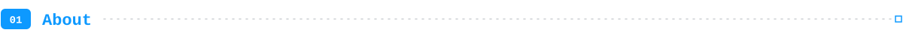

I'm a full-stack web developer and Computer Engineering graduate (ITS, 2026) from Sidoarjo, Indonesia. I work mostly with Next.js and React, and I design the interface in Figma before I build it.

- **Building** the Next.js and TypeScript web app of a ta'aruf (marriage matchmaking) platform at Qobiltu Indonesia, as the main contributor.
- **Shipping** IoT dashboard widgets in Angular at PT XLSMART Telecom Sejahtera (internship, 2026) and Laravel ERP modules at PT Aldzama (internship, 2025).
- **Designing** product UI/UX, with a first-place finish at the ITCC 2023 UI/UX Design Competition.

 

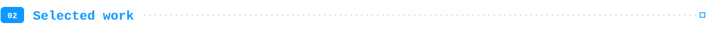

  <a href="https://github.com/rigelra15/Lyrette"></a>
  <a href="https://ruangkopisby.vercel.app">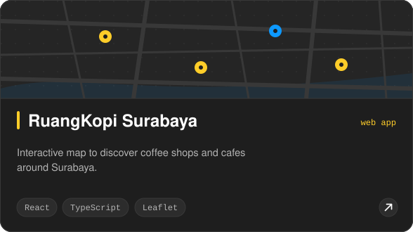</a>

  <a href="https://github.com/rigelra15/RescueHub">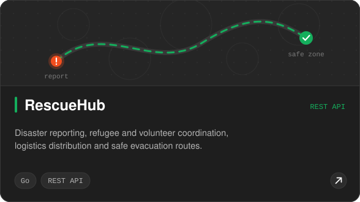</a>
  <a href="https://github.com/rigelra15/CineCritic"></a>

<b>More things I've built</b>

 

| Project | What it is | Stack | Link |
| :-- | :-- | :-- | :-- |
| **Budgetly** | Personal budgeting app, on mobile and web | Flutter, React | [app](https://github.com/rigelra15/budgetly-app) · [web](https://budgetly-web.vercel.app) |
| **HyperTopia Installer** | Installer app with signed Android release builds | Android | [releases](https://github.com/rigelra15/hypertopia-installer-android-releases) |
| **Semaphore Pose Estimation** | Reading semaphore poses with computer vision | Python, OpenCV | [repo](https://github.com/rigelra15/semaphore_pose_estimation_opencv) |
| **Matrix Pong** | Pong on an LED matrix for an embedded systems class | C++ | [repo](https://github.com/rigelra15/matrix_pong_embsys) |
| **Bookly API** | Book management REST API | Go | [repo](https://github.com/rigelra15/bookly-api-golang) |

 

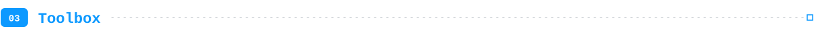

<table>
  <tr>
    <td><b>Frontend</b></td>
    <td></td>
  </tr>
  <tr>
    <td><b>Backend + database</b></td>
    <td></td>
  </tr>
  <tr>
    <td><b>Tools</b></td>
    <td></td>
  </tr>
  <tr>
    <td><b>Side projects</b></td>
    <td></td>
  </tr>
</table>

 

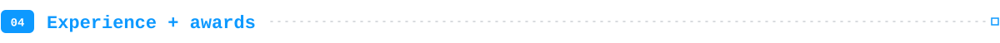

| When | Role | Where |
| :-- | :-- | :-- |
| Mar 2025 to present | **Web Developer** (freelance, project contract) | Qobiltu Indonesia, Surabaya |
| Feb 2026 to Aug 2026 | **Full-stack Developer Intern** | PT XLSMART Telecom Sejahtera Tbk, Jakarta |
| Apr 2025 to Dec 2025 | **Web Developer Intern** | PT Aldzama, Gresik |
| Mar 2023 to Aug 2026 | **Software Engineer** | Bayucaraka UAV Research Team, Surabaya |
| May 2024 to Oct 2024 | **Co-Founder and CTO** | aibeecara, Surabaya |
| Feb 2025 to Jul 2025 | **Solo Full-stack Developer** | NewsInsight, an AI news fact-checking platform |

Education: Bachelor of Computer Engineering, Institut Teknologi Sepuluh Nopember, Surabaya (Aug 2022 to Aug 2026).

<b>What I did in each role</b>

 

- **Qobiltu Indonesia**: main contributor (540+ commits) to a Next.js and TypeScript app with checkout and premium gating, a CV builder and an academy; built a shared UI kit for desktop and mobile, server-side rendering and static generation, and NextAuth/OAuth login.
- **PT XLSMART Telecom Sejahtera Tbk**: built a library of 15+ reusable IoT dashboard widgets in Angular, optimized map overlays, wrote room-booking API endpoints, and built Node-RED billing workflows for water and electricity.
- **PT Aldzama**: worked on frontend and backend logic across five Laravel ERP modules for HR and payroll, including data import, export and reporting.
- **Bayucaraka UAV Research Team**: built a web-based Ground Control Station with React, TypeScript and Tailwind CSS, with real-time telemetry displays; team finalist at KRTI 2024.
- **aibeecara**: built an Android app in Flutter for AI-powered language conversation practice, and its React landing page.
- **NewsInsight**: a Next.js frontend, an Express and PostgreSQL backend and a newsroom dashboard, with Gemini and Google Fact Check for automated fact-checking, plus OAuth, MFA and role-based access.

<b>Awards and training</b>

 

- **1st Place**, UI/UX Design, ITCC 2023
- **Finalist**, GemasTIK 2024 (UX)
- **Top 10**, Intuitiva 2024 UI/UX Design
- **Best Team Project**, UX Academy ISE 2023
- **Training**: Next.js 15 and React, Dicoding

 

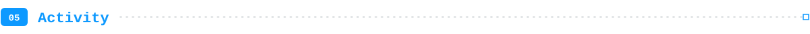

  <picture>
    <source media="(prefers-color-scheme: dark)" srcset="https://raw.githubusercontent.com/rigelra15/rigelra15/output/github-contribution-grid-snake-dark.svg">
    <source media="(prefers-color-scheme: light)" srcset="https://raw.githubusercontent.com/rigelra15/rigelra15/output/github-contribution-grid-snake.svg">
    
  </picture>

 

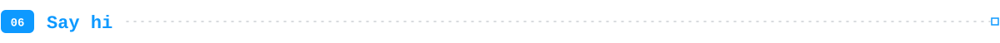

Have a product that needs both a designer's eye and working code? I'd like to hear about it.

  
  
  
  

